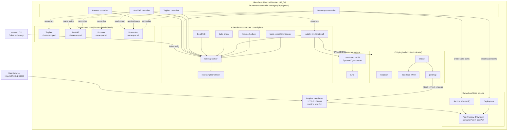
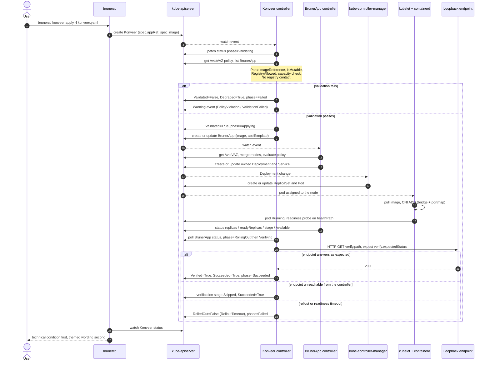

# Brunernetes architecture

Brunernetes is a single-node Kubernetes distribution and developer experience
layer. It installs upstream Kubernetes on one Linux host with kubeadm, adds four
custom resources in the `bruner.dev/v1alpha1` API group, a controller manager
that reconciles them, and the `brunerctl` CLI. It runs exactly one web
application and publishes it on the loopback interface of the host.

It is not a Kubernetes fork. No control-plane component is patched, replaced or
wrapped. See [ADR 0001](adr/0001-single-node-upstream-kubernetes.md).

## Layers

The system is five layers thick, and each layer is deliberately thin.

1. **Host.** Ubuntu or Debian, x86_64, recommended 2 vCPU / 4 GB RAM / 20 GB
   disk. Swap off, cgroup v2, `overlay` and `br_netfilter` loaded,
   `net.bridge.bridge-nf-call-iptables` and `net.ipv4.ip_forward` set. Owned by
   the installer; see [installation.md](installation.md).
2. **Runtime.** `containerd` with the CRI plugin enabled and
   `SystemdCgroup = true`, talking to `runc`. The kubelet is the only client of
   the containerd socket that Brunernetes relies on.
3. **Kubernetes.** A kubeadm-bootstrapped control plane: `kube-apiserver`,
   `etcd`, `kube-controller-manager` and `kube-scheduler` as static pods;
   `kubelet` as a systemd unit; `kube-proxy` as a DaemonSet; `CoreDNS` as a
   Deployment. Pod networking is the reference CNI chain `bridge` + `loopback` +
   `host-local` + `portmap`. The control-plane taint is removed so the node also
   runs workloads.
4. **Brunernetes control layer.** One controller manager Deployment, installed
   by the Helm chart together with the four CRDs, running four controllers.
5. **Product layer.** One `BrunerApp` and the `Deployment` plus `Service` it
   owns, published at `http://127.0.0.1:30080` by default.

## Component diagram

## Delivery sequence

A `Konveer` delivery of an already-built image, end to end. Konveer never builds
an image; see [ADR 0004](adr/0004-delivery-without-image-build.md).

**Implementation note.** The diagram shows the target design, in which a Konveer
controller drives the delivery. In v0.1 there is no Konveer reconciler: the
`brunerctl konveer apply` command performs the same four stages in-process and
writes the same `Konveer.status`, so every message in the sequence still occurs,
with `brunerctl` in the place of the controller. The differences and the
migration path are in [reconciliation.md](reconciliation.md).

## Data flow

**Desired state in.** The user writes YAML. Either `brunerctl app deploy -f`
creates or updates a `BrunerApp` directly, or `brunerctl konveer apply -f`
creates a `Konveer` that in turn writes to a `BrunerApp`. Both paths go through
the kube-apiserver with the user's kubeconfig, and both are subject to the CRD
OpenAPI schema generated from the kubebuilder markers in `api/v1alpha1` - enums,
minimums, maximums, patterns and defaults are applied by the API server before
anything is persisted to etcd.

**Reconciliation.** The controller manager watches the four kinds plus the
resources it owns. The `BrunerApp` controller reads the cluster-scoped `AvtoVAZ`
to obtain the factory policy, merges `AvtoVAZ.spec.defaultMode` with
`BrunerApp.spec.mode` through `MergeModes` (application overrides factory,
unset fields fall back to `DefaultMode()` = `garage`/`steady`/`practical`/`day`),
evaluates policy, and then reconciles one `Deployment` and one `Service` with
owner references pointing back at the `BrunerApp`. The `Konveer` controller
writes only to `BrunerApp` objects and to its own status. The `Togliatti` and
`AvtoVAZ` controllers write only status. In v0.1 the `BrunerApp` controller is
the only one that exists; the `Konveer` stages run inside `brunerctl`, and the
`Togliatti` and `AvtoVAZ` statuses are not written at all - `brunerctl` inspects
the live cluster instead. Implementation status per controller is tracked in
[reconciliation.md](reconciliation.md).

**Observed state out.** The kubelet reports pod status; `kube-controller-manager`
aggregates it into the Deployment status; the `BrunerApp` controller aggregates
that into `status.replicas`, `status.readyReplicas`, `status.stage` and the
`Reconciling` / `Available` / `Degraded` / `PolicyWarning` conditions. The
`Konveer` controller aggregates the `BrunerApp` status plus its own HTTP
verification into `status.phase`, `status.stages` and the `Validated` /
`RolledOut` / `Verified` / `Succeeded` conditions. `brunerctl status`,
`brunerctl app inspect`, `brunerctl events` and `brunerctl diagnose` read those
fields and the associated Events; they compute nothing the API does not already
report.

**Traffic.** The browser connects to `127.0.0.1:30080`. The `portmap` CNI plugin
DNATs that to the pod IP on the `cni0` bridge. The `ClusterIP` Service is the
in-cluster path and is created unconditionally; it is what CoreDNS resolves and
what `status.clusterIPEndpoint` reports. See
[ADR 0003](adr/0003-localhost-only-exposure.md).

**Status messages.** Every human-readable message in a condition, an event or
CLI output states the technical condition first and the themed wording second,
for example: "All replicas are ready. Assembly completed and product cleared for
the showroom." The themed vocabulary never replaces a technical fact, and the
machine-readable `reason` field is always a plain constant from
`api/v1alpha1/common_types.go`.

## Trust boundaries

| # | Boundary | Crossing | Who is trusted | Controls |
| --- | --- | --- | --- | --- |
| 1 | Off-host network → host | Nothing, by design | Nobody | No Kubernetes Service is published on a routable address. `hostIP` is schema-constrained to `127.x.x.x`; `allowPublicExposure` is schema-constrained to `false`. The API server port 6443 does listen on the node address and is the one genuinely exposed surface - it must be firewalled by the operator |
| 2 | Host user → loopback endpoint | HTTP, plaintext, unauthenticated | Any local user or process on the host | None. Any process on the host can reach `127.0.0.1:30080`. The application is a static read-only page; nothing sensitive is served. There is no TLS. See [security.md](security.md) |
| 3 | Host user → kube-apiserver | mTLS with the client certificate in `/etc/kubernetes/admin.conf` | Whoever can read that file (root, or a member of the group the installer grants) | File permissions only. `admin.conf` is a full cluster-admin credential with no expiry-driven revocation path |
| 4 | Installer → host | `sudo` for package installation, kernel modules, sysctls, containerd configuration, `kubeadm init/reset`, CNI files, `systemctl` | The user running the installer | Explicit `sudo` table and dry-run mode in [installation.md](installation.md); the installer performs no network fetch it does not declare |
| 5 | Controller manager → kube-apiserver | ServiceAccount token, RBAC | The controller's ServiceAccount | Cluster-scoped role limited to the `bruner.dev` kinds plus Deployments, Services, Pods, Events and Nodes. The controller does not need or receive the containerd socket, host mounts or privileged capabilities |
| 6 | Controller manager → application endpoint | HTTP GET during `Konveer` verification | The application's own `/healthz` | The check is read-only, bounded by `spec.timeouts`, and is skipped rather than failed when unreachable |
| 7 | Registry → node | Image pull by containerd, optionally with `imagePullSecrets` | The registry operator and every maintainer of every layer | None beyond `allowedRegistries` prefix matching and `latestTagPolicy`. Brunernetes never verifies signatures. See [ADR 0004](adr/0004-delivery-without-image-build.md) |
| 8 | Workload pod → control plane | Shared node, shared kernel, shared kubelet | The application image | The control-plane taint is deliberately removed, so this boundary is thin: a workload that exhausts CPU, memory or disk degrades the API server. Accepted as a documented consequence of single-node operation |

Boundaries 1 and 2 are the ones that define the product: nothing is reachable
from off-host, and everything is reachable from on-host. Boundary 8 is the one
that is deliberately weakened, and it is the reason Brunernetes carries no
production support claim.

## Related documents

- [ADR 0001: Single node on upstream Kubernetes](adr/0001-single-node-upstream-kubernetes.md)
- [ADR 0002: CRD and controller boundary](adr/0002-crd-and-controller-boundary.md)
- [ADR 0003: Localhost-only exposure](adr/0003-localhost-only-exposure.md)
- [ADR 0004: Delivery without image build](adr/0004-delivery-without-image-build.md)
- [api.md](api.md) - the CRD reference
- [reconciliation.md](reconciliation.md) - controller responsibilities
- [installation.md](installation.md) - install and uninstall flow
- [repository-structure.md](repository-structure.md) - where the code lives
- [security.md](security.md) - risks and mitigations
